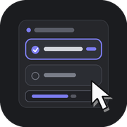

# dsh-better-choice



[](https://github.com/TLEWA/dsh-better-choice/actions/workflows/ci.yml)
[](https://github.com/TLEWA/dsh-better-choice/releases)
[](https://www.npmjs.com/package/dsh-better-choice)
[](LICENSE)

[简体中文](README.md) · [English](README.en.md)

An enhancement for DeepSeek Harness's `ask_user_question` card:

- **Right-click an option to annotate it** — a note field opens directly under that
  option, and the note travels to the model with the selection, instead of forcing
  a paragraph into the free-form "other" row.
- **Ask a side question before choosing** — a side-ask box at the bottom of the card
  answers from the live conversation. The answer stays in the card: it is not
  submitted, does not touch the main conversation, and never chooses for you.

Left-click selection, skip, previous/next, countdown, and "answer slowly" all behave
exactly as before. Plan-review, approval, and other non-generic cards remain with the
official composer.

## Features

| Capability | Behavior |
| --- | --- |
| Right-click note | Right-clicking opens the note field and selects the option unless the bottom custom answer already wins; moving to the next question folds it and keeps the text |
| Per-option memory | Single- and multi-select keep one independent note per option; switching options never mixes drafts |
| Protocol unchanged | `selected` still carries the original labels; notes are merged into `custom`; no notes means the official payload, byte for byte |
| Notes on unselected options | In multi-select, a note on an unchecked option is marked `(unselected)` so the model can tell |
| Side ask with context | A fork child reuses the current session's completed context, model, and tool declarations |
| No interruption | Per-question threads, multiple follow-ups; focusing the side box pauses the card countdown and blur resumes it; sending switches the card to "waits for you" |
| Cancellable | A "Cancel side ask" button appears while the answer runs; the thread keeps a cancelled marker so you can rephrase; cancelling or the 30-minute timeout stops and releases the fork child |
| Read-only | A runtime guard denies every tool call; it never resumes the task or chooses; capped at 32K output tokens (not above the parent limit) |
| Official behavior kept | Left-click, free-form row, skip, paging, countdown, post-timeout continuation, and settled-answer review are untouched |

### Right-click notes

In single-select, right-clicking an option selects it and opens a note field below it. If a
bottom custom answer is already typed, that answer wins and the selection stays empty, so
the note is submitted as `(unselected)`. The note does not replace the option; it is attached
to it:

```json
{
  "answers": [
    {
      "id": "question-id",
      "selected": ["Option B"],
      "custom": "Option B: roll out to 5% first, watch for an hour, then ramp"
    }
  ]
}
```

In multi-select, each option gets its own note and each note becomes one line:

```text
Option A: keep the legacy endpoint
Option C: remove it next iteration
```

With no notes, the request is identical to stock DSH and no `custom` is added.

### Side ask

The bottom of the question card has a "ask first" box. Enter sends, Shift+Enter
inserts a newline. The answer appears in the card when complete, and you can ask
follow-ups. It uses the session's model and context, but:

- it starts a fork child with `delivery: 'caller'`, attached to the current command
  invocation rather than queued for the parent turn, so it answers even while the parent
  is blocked on `ask_user_question`;
- it never writes the Q&A back to the parent message flow; the child has its own session
  log, while the parent records only `command/run`, `subagent/catalog`, and
  `command/done` (with no question text);
- a runtime guard denies every tool call; it edits no files and never submits the answer.

The countdown does not force your hand: put the cursor in the side box and the card shows
"paused" while the timer is held; blur it and the countdown resumes. Sending a side question
switches the card to "waits for you", so waiting for an answer can no longer time the card
out. Threads are stored per question, so switching questions and coming back keeps each
conversation; "Cancel side ask" aborts an answer in flight, and each thread keeps at most
20 turns.

Good questions: "What is the production difference between these two options?",
"Which files would option B touch?", "Where did that conclusion come from?"
Then choose.

## Installation

Requires the DSH 0.2.0-rc family (`engines.dsh: >=0.2.0-rc.1 <0.3.0-0`, client
packages `^0.2.0-rc.1`) and Node.js 20+; verified on DSH `0.2.2-rc.1`.

### From npm (recommended)

1. Open **Plugins** in the sidebar → **Install plugin**;
2. Enter the package name:

   ```text
   dsh-better-choice
   ```

3. Hard-refresh after installation (`Ctrl+Shift+R`); restart the desktop app if the
   host half has not loaded.

Pin a version:

```text
dsh-better-choice@1.2.0
```

Equivalent CLI:

```powershell
dsh plugin --profile desktop add dsh-better-choice@1.2.0
```

### From GitHub

`lib/` is committed, so no local build is needed:

```text
https://github.com/TLEWA/dsh-better-choice
```

Pin a tag:

```text
https://github.com/TLEWA/dsh-better-choice#v1.2.0
```

Or install the release asset directly:

```text
https://github.com/TLEWA/dsh-better-choice/releases/latest/download/dsh-better-choice.tgz
```

Equivalent CLI:

```powershell
dsh plugin --profile desktop add github:TLEWA/dsh-better-choice#v1.2.0
```

### From source

```powershell
git clone https://github.com/TLEWA/dsh-better-choice.git
cd dsh-better-choice
npm install
npm run build
npm test
dsh plugin --profile desktop add .
```

Hard-refresh after installing or upgrading. If the host command `bc-ask` is not
registered, the side-ask box reports an error; restart the desktop app.

## Usage

1. Wait for a normal choice question from the model;
2. To add constraints: right-click an option, write the note, then submit normally;
3. To verify something first: ask in the bottom box, read the answer, then choose;
4. Both can be used together; side-ask content never enters the final answer.

On a trackpad, right-click is usually a two-finger tap. Devices without a right-click
can still answer normally with the left button; only the note field is unavailable.

## How it works

### Client: first in the official composer chain

The browser half registers into the `conversation.composer` chain at `priority: -10`
(the official entry is at 0), so it is asked first. Its selector recognizes a generic
`PendingQuestion` carrier structurally and returns `null` for anything else, which
falls through to the official composer.

The component is a port of the official generic question flow: card anatomy,
recommended-label parsing, countdown, free-form row, and submit logic are preserved.
Only the per-option note editor and the bottom side-ask thread are added. Styles are
derived from the official card CSS with a `bc_` prefix.

### Host: a read-only side-ask command

The side ask runs through this plugin's own `bc-ask` command. The client serializes the
question, all question cards, any notes, and the previous turns in this side thread; the
host:

- starts a fork child with
  `ctx.subagents.startActivation({ provider: 'fork', delivery: 'caller' })`; the fork
  provider seeds the child with the parent's completed turns up to the last `turn/end`,
  excluding the in-flight tool-call turn;
- appends one trailing user message (side-ask mode + cards + previous side turns + this
  question) and leaves the system prompt, tool declarations, and history untouched, so
  the prefix matches the parent's completed turns;
- inherits the parent's provider / model / reasoningEffort, sets
  `maxTokens = min(32000, parent.maxTokens)`, and forwards both the parent signal and a
  30-minute watchdog;
- installs a `tools.guard` on the child that rejects every tool call; the answer is text
  only, with stray `<tool_call>` markup removed;
- never writes the Q&A back to the parent session. The parent records only
  `command/run`, `subagent/catalog`, and `command/done`, with `recordInput: false` so the
  question text is not persisted.

The fork child reuses the parent's completed-turn prefix, so the provider can hit the
existing prompt cache. In a real host run, both the main request and the following fork
child request reported non-zero `cacheReadTokens`, growing as the parent completed more
turns (DeepSeek uses automatic prefix caching on this route).

## Layout

```text
src/index.ts                 Host: bc-ask command, fork child, side prompt
src/client/index.ts          Client: styles, locales, slot registration, bridge
src/client/composer.tsx      Enhanced card: notes, side thread, submit assembly
src/client/carrier.ts        Structural PendingQuestion matching
src/client/draft-store.ts    Draft and note storage across renders
src/client/side.ts           Side-ask service interface
src/client/locales.ts        Chinese and English copy
src/client/styles.ts         Generated by scripts/gen-css.mjs
scripts/build.mjs            esbuild (client CJS envelope + host ESM)
scripts/gen-css.mjs          Generates prefixed CSS from the reference styles
scripts/upstream-composer.module.css  Vendored upstream MIT stylesheet
lib/                         Committed build output, installable as-is
cordis.patch.yml             Bundle patch inserting the host row
test/package.test.mjs        Package metadata, artifacts, manifest checks
```

## Development

```powershell
npm install
npm run build
npm run check
npm test          # node:test
npm pack
```

`prepack` rebuilds, checks, and tests before packing. The client artifact is CJS inside
the `window.__ModuleLoader__` envelope; the host artifact is unbundled ESM.

## Compatibility

Type-checked against the DSH `0.2.2-rc.1` composer slot and `PendingQuestion` contract;
the manifest declares `engines.dsh: >=0.2.0-rc.1 <0.3.0-0`, peer dependencies are
declared as `^0.2.0-rc.1`, and it is verified on a real
`0.2.2-rc.1` web host. If a DSH upgrade changes the internal card structure:

- the enhanced card declines to claim it and the official card still works;
- the side ask depends on the host command, `ctx.subagents.startActivation`, and the fork
  provider; if those change it reports an error, but normal answering is unaffected.

## Known limitations

- Only generic choice cards are claimed; plan review and approval remain official.
- The side ask uses the current session's model; there is no separate model or
  reasoning-effort picker.
- The side ask is read-only: questions that need file reads or commands should be asked
  in the main conversation.
- The fork seed ends at the parent's last completed turn; the in-flight turn (the one
  waiting for your answer) is not included, so the side ask learns about it from the card
  and the previous side turns.
- The side answer appears as a whole when complete rather than token by token; long
  answers are capped at 32K output tokens.
- Devices without right-click cannot use notes, but left-click answering is unaffected.

## Other DSH projects I work on

Question cards are only one corner of DSH. These are the other plugins I maintain — take what fits.

- **[dsh-sidebar-row-menu](https://github.com/TLEWA/dsh-sidebar-row-menu)** — right-click menus for sidebar rows: workspace menu and native session menu extensions, with open-with submenus, pinned apps, per-item menu placement, and archived-session cleanup.
- **[dsh-sidebar-organizer](https://github.com/TLEWA/dsh-sidebar-organizer)** — a layout organizer for seven regions: sidebar, sidebar footer, conversation tabs, composer, session header, right panel, and settings navigation all support long-press drag to reorder, and panels can be tucked into "More".
- **[dsh-if](https://github.com/TLEWA/dsh-if)** — the `/if` command: let the model judge a condition from prior context, then send the instruction below it as a user message only when it holds.
- **[dsh-utf8-output](https://github.com/TLEWA/dsh-utf8-output)** — fixes GBK/CP936/GB18030 mojibake from DSH subprocess output on Windows.
- **[dsh-opencode-go-router](https://github.com/TLEWA/dsh-opencode-go-router)** — rotates OpenCode Go routing after a context fold or a system-prompt rewrite, so less of the prompt cache is lost.
- **[dsh-fastload](https://github.com/TLEWA/dsh-fastload)** — trims the first history page of long sessions while preserving the tail the user actually sees.
- **[dsh-ptc-noargs](https://github.com/TLEWA/dsh-ptc-noargs)** — fixes rejected argument-less tool calls in PTC `run_code` by normalizing an omitted or `undefined` first argument to `{}`.

## License and attribution

Released under [MIT](LICENSE). The question-card component structure and styles are
derived from [`dsh-question-note`](https://github.com/buaaflyaway/dsh-question-note)
(MIT, NedFlanders). The side-ask interaction was inspired by
[`dsh-btw`](https://github.com/MichengAI/dsh-btw) (Apache-2.0). See
[NOTICE.en.md](NOTICE.en.md) for the exact scope and license texts, and
[AI_USAGE.en.md](AI_USAGE.en.md) for AI involvement and verification boundaries.

DeepSeek Harness and its bundled packages remain copyright DeepSeek; this project's MIT
license does not change their terms.

See [CHANGELOG.en.md](CHANGELOG.en.md) for changes ([中文](CHANGELOG.md)).

## Codex PR review

This repository adopts the v1 shared review block in AGENTS.md from [central CI](https://github.com/TLEWA/dsh-plugin-ci). Cloud Codex reviews PRs and new commits; maintainers retain final approval and merging. Review results must cover the latest commit. Review consumes subscription usage; use `@codex review` for missing results.
