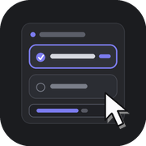

# dsh-better-choice



[](https://github.com/TLEWA/dsh-better-choice/actions/workflows/ci.yml)
[](https://github.com/TLEWA/dsh-better-choice/releases)
[](https://www.npmjs.com/package/dsh-better-choice)
[](LICENSE)

[简体中文](README.md) · [English](README.en.md)

给 [DeepSeek Harness](https://github.com/deepseek-ai)（DSH）的 `ask_user_question`
问题卡片加两个能力：

- **右键选项写补充**：右键任意选项，就在该选项下方展开一个补充说明输入框；
  提交时说明与所选项一起交给模型，不用把一整段解释塞进「其他」。
- **先问一句再选**：卡片底部有一个旁问框，基于当前会话的真实上下文回答你的疑问；
  答案只显示在卡片里，不提交、不污染主对话，也不替你做出选择。

左键选择、跳过、上一题 / 下一题、倒计时与「慢慢回答」等官方行为全部保留。
计划审查（plan-review）、审批等非通用问题卡片仍由官方组件处理。

## 功能

| 能力 | 行为 |
| --- | --- |
| 右键展开补充框 | 右键选项即选中该项（若尚未选中）并展开输入框；切到下一题时自动收起，文字保留 |
| 每个选项独立记忆 | 单选、多选都按选项分别保存补充内容，切换选项不会串稿 |
| 提交不改变协议 | `selected` 仍是原始选项文字；补充说明合并进 `custom`，无补充时与官方请求完全一致 |
| 未选也可备注 | 多选时给未勾选的选项写了备注，提交文本会标注 `(未选)`，模型能分清语气 |
| 旁问当前会话 | 复用当前会话的模型、历史、工具声明与工具历史，回答「这个选项到底什么意思」这类问题 |
| 旁问不打断作答 | 独立线程、可连续追问；不写入会话日志，不改变主对话的缓存前缀 |
| 旁问只读 | 旁问不会调用工具、不会继续原任务、不会替用户选择；输出上限 700 tokens |
| 官方交互保留 | 左键选择、自由输入行、跳过、翻页、倒计时、超时后续答、已结算回看均不受影响 |

### 右键补充

单选时右键某个选项，会先选中它，再在选项下方展开输入框。填写的内容不会替换选项，
而是作为该选项的附注：

```json
{
  "answers": [
    {
      "id": "question-id",
      "selected": ["方案 B"],
      "custom": "方案 B: 先灰度 5%，观察一小时再全量"
    }
  ]
}
```

多选时每个选项各有一条附注，提交时一行一个：

```text
方案 A: 需要保留旧接口
方案 C: 下个迭代再删
```

没有填写任何附注时，请求与官方完全一致，不额外生成 `custom`。

### 旁问

问题卡片底部有「先问一句」输入区。Enter 发送，Shift+Enter 换行；回答以流式显示，
可以继续追问。旁问使用当前会话的模型与上下文，但：

- 不启动子代理，不会因为父会话正卡在 `ask_user_question` 而死锁；
- 不把问答写进 session，主对话的上下文与 prompt 缓存前缀保持不变；
- 不产生工具调用，不修改文件，也不替你提交答案。

适合问：「这两个选项在生产环境下的差别是什么？」「选 B 的话需要改哪些文件？」
「刚才那个结论的依据在哪？」——问完再点选项。

## 安装

要求 DSH 0.2.0-rc 族（客户端内置包 `^0.2.0-rc.1`），Node.js 20+。

### 从 npm 安装（推荐）

1. 打开侧边栏 **插件** 页 → **安装插件**；
2. 输入包名并确认：

   ```text
   dsh-better-choice
   ```

3. 安装完成后硬刷新（`Ctrl+Shift+R`）；若宿主半边未生效，重启桌面端。

固定版本：

```text
dsh-better-choice@1.0.0
```

命令行等价写法：

```powershell
dsh plugin --profile desktop add dsh-better-choice@1.0.0
```

### 从 GitHub 安装

仓库的 `lib/` 已是可直接运行的产物，安装时不需要本地构建：

```text
https://github.com/TLEWA/dsh-better-choice
```

固定到标签：

```text
https://github.com/TLEWA/dsh-better-choice#v1.0.0
```

或直接安装 Release 附件：

```text
https://github.com/TLEWA/dsh-better-choice/releases/download/v1.0.0/dsh-better-choice-1.0.0.tgz
```

命令行等价写法：

```powershell
dsh plugin --profile desktop add github:TLEWA/dsh-better-choice#v1.0.0
```

### 从源码安装

```powershell
git clone https://github.com/TLEWA/dsh-better-choice.git
cd dsh-better-choice
npm install
npm run build
npm test
dsh plugin --profile desktop add .
```

安装或升级后硬刷新页面；宿主命令 `bc-ask` 未注册时，旁问框会提示失败，重启桌面端即可。

## 使用

1. 等模型发起一个普通的选择题；
2. 想补充约束：右键选项，写完后正常提交；
3. 想先确认信息：在底部旁问框提问，看完回答再选；
4. 两者可以同时使用，旁问内容不会进入最终答案。

右键在触控板上通常是双指点按；没有右键的设备仍可正常左键作答，只是用不到补充框。

## 实现

### 客户端：接在官方 composer 链上

浏览器半边向 `conversation.composer` 链式槽注册，`priority: -10`（官方默认 0），
因此先于官方组件被询问。选择器以结构化方式识别通用 `PendingQuestion` 载体；
识别失败或不是通用问题卡时返回 `null`，自动落回官方组件。

组件本身是官方通用问题流程的移植：保留卡片结构、推荐标记解析、倒计时、
自由输入行与提交逻辑，只增加「按选项的补充框」与「底部旁问线程」。
样式由官方问题卡 CSS 派生并加 `bc_` 前缀，避免污染其他插件。

### 宿主：一个只读的旁问命令

旁问通过本插件自己的命令 `bc-ask` 完成，客户端把问题、当前卡片和已写备注序列化后
交给宿主。宿主：

- 用 `agent.session.deriveMessages()` 取当前会话已投影的消息，去掉末尾尚未配对的
  assistant tool-call / tool 消息（待决问题会让历史停在这里），超长时从最旧处裁剪；
- 复用会话的 provider / model / reasoningEffort，以及请求头里的工具声明和
  `toolHistory()`，尽量让前缀与主请求保持一致；
- 在末尾追加一条临时 user 消息，调用 `ctx.llm.stream()`，只读取文本；
- 不写 session、不创建子代理、不执行工具。

这也是为什么不用 `/btw` 或 fork 子会话：父回合正被待决问题阻塞，子代理可能永远等不到
自己的回合；直接调用 LLM 流则没有这个依赖。

迁移与裁剪都以「不破坏主对话前缀」为优先：正常长度的会话，旁问请求的前缀就是主请求
的前缀，provider 可以命中已有缓存。

## 目录

```text
src/index.ts                 宿主入口：bc-ask 命令、历史裁剪、旁问提示词
src/client/index.ts          客户端入口：样式、词典、slot 注册、旁问桥
src/client/composer.tsx      增强问题卡：右键补充、旁问线程、提交组装
src/client/carrier.ts        结构化识别通用 PendingQuestion
src/client/draft-store.ts    草稿与备注的跨渲染存储
src/client/side.ts           旁问服务接口
src/client/locales.ts        中英文案
src/client/styles.ts         由 scripts/gen-css.mjs 生成的样式
scripts/build.mjs            esbuild 构建（客户端 CJS 信封 + 宿主 ESM）
scripts/gen-css.mjs          从参考样式生成带前缀的 CSS
scripts/upstream-composer.module.css  上游 MIT 样式（已内置，构建无需外部目录）
lib/                         构建产物（已提交，可直接安装）
cordis.patch.yml             bundle patch：把宿主行插入 profile 插件树
test/package.test.mjs        包元数据、产物与清单校验
```

## 开发

```powershell
npm install
npm run build     # 产出 lib/index.js 与 lib/client.js
npm run check     # 产物语法检查
npm test          # node:test
npm pack          # 生成可安装的 .tgz
```

`npm pack` 的 `prepack` 会重新构建、检查并跑测试。客户端产物是带
`window.__ModuleLoader__` 信封的 CJS，宿主产物是不打包的 ESM。

## 兼容性

按 DSH 客户端 `0.2.1-rc` 族的 composer 槽与 `PendingQuestion` 形状实现，peer 依赖
声明为 `^0.2.0-rc.1`。DSH 升级若改动问题卡内部结构：

- 识别失败时增强卡片不接管，官方问题卡仍可用；
- 旁问依赖宿主命令与 `ctx.llm.stream`，接口变化时旁问会报错，但不影响正常作答。

## 已知限制

- 只接管通用选择题；计划审查、审批等卡片保持官方实现。
- 旁问固定在当前会话的模型上，不提供单独选择模型或推理强度的入口。
- 旁问是只读的：需要读文件、跑命令才能回答的问题，应直接在对话里问。
- 极端长的会话会从最旧处裁剪旁问上下文；旁问看到的是最近的一部分。
- 没有右键输入的设备无法使用补充框，但左键作答完全不受影响。

## 许可与来源

本项目以 [MIT](LICENSE) 发布。问题卡的组件结构与样式派生自
[`dsh-question-note`](https://github.com/buaaflyaway/dsh-question-note)
（MIT，NedFlanders）；旁问交互参考了
[`dsh-btw`](https://github.com/MichengAI/dsh-btw)（Apache-2.0）的设计。
具体复用范围与许可证全文见 [NOTICE.md](NOTICE.md)；
AI 参与范围与验证边界见 [AI_USAGE.md](AI_USAGE.md)。

DSH 本身及其内置包的版权归 DeepSeek 所有，不因本项目的 MIT 许可而改变。
